# Novelmaker

**English** · [Deutsch](README.de.md) · [Español](README.es.md) · [Українська](README.uk.md) · [Italiano](README.it.md) · [Français](README.fr.md)

A local writing app for novels, with AI help built into the manuscript. Novelmaker runs in your browser on `localhost` and keeps everything in a single SQLite file on your computer. It works with the AI models you choose: through OpenRouter, or with a model running on your own machine (Ollama, LM Studio, KoboldCpp, …).

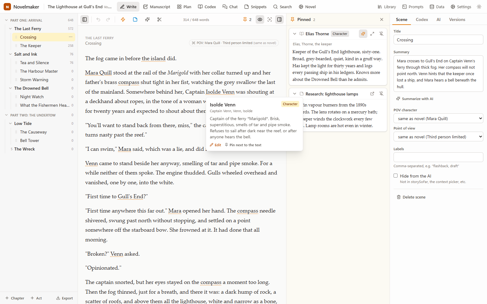

<sub>All screenshots show invented demo data.</sub>

## Contents

- [Why Novelmaker exists](#why-novelmaker-exists)
- [What Novelmaker is](#what-novelmaker-is)
- [Feature tour](#feature-tour)
- [Languages](#languages)
- [Getting started](#getting-started)
- [How it works](#how-it-works)
- [Importing novels](#importing-novels)
- [Prompt reference](#prompt-reference)
- [Data, backups and several computers](#data-backups-and-several-computers)
- [Keyboard shortcuts](#keyboard-shortcuts)
- [Configuration](#configuration)
- [Development](#development)
- [Known limitations](#known-limitations)

## Why Novelmaker exists

The idea for Novelmaker comes from [Novelcrafter](https://www.novelcrafter.com): a writing app where the AI works right inside the manuscript. I just wanted it without a website and without a subscription.

My biggest problem was the rhythm of my writing. Phases of creative ease, in which I used Novelcrafter a lot, were followed by phases in which I wrote nothing at all, and the subscription kept running. Most of the time I was too lazy or too forgetful to pause it. With Novelmaker you only pay your AI provider, and only for what you actually generate. With a local model you pay nothing at all.

A big thank-you and huge kudos to Novelcrafter. Novelmaker is not meant to compete with them in any way. I built it for myself, and anyone who would like to use it is welcome to.

Novelmaker has no server on the internet, so your data stays on your computer (except for the prompts you send to your AI provider). That also means:

- **Backups are up to you.** Novelmaker makes backup copies automatically, but on your own disk. Keeping a copy somewhere else (another drive, a cloud folder) is your job.
- **Bring your own keys.** You need your own API key, e.g. for OpenRouter, or a model running on your own machine.

## What Novelmaker is

Novelmaker is for people who write long fiction and want AI help **inside the manuscript** rather than in a separate chat window. You write. When you want the AI to draft a passage, you leave an instruction in the text, called a *beat* (for example "Mara asks about the missing ledger; he changes the subject"), and click *Generate*. Novelmaker builds the prompt for you. It includes the text before the cursor, summaries of the earlier scenes, and only those codex entries (characters, places, lore) that matter for this scene. You read the result and decide what to keep.

What it is built around:

- **Local and private.** One user, no account, no cloud service of its own. Your text leaves your computer only as part of the prompts you send to the AI provider you set up.
- **Your choice of model.** Any OpenAI-compatible API works: OpenRouter (hundreds of models, with prices), Ollama, LM Studio, KoboldCpp or your own server.
- **Transparent.** You can see exactly what goes to the AI (rendered prompt, codex selection with reasons) and what it costs, before you click and afterwards.
- **You stay the author.** AI output never silently replaces your text. You accept it, stash it as a variant, regenerate it or throw it away. Before every accepted change, Novelmaker saves a version of the scene.
- **Multilingual.** Interface and built-in prompts in English, German, Spanish, Ukrainian, Italian and French. Your novel can be in any language your model knows (see [Languages](#languages)).

Not in scope: multiple users, logins, hosting on the internet, a sync service. API keys are stored in plain text in the local database, so don't expose the server beyond `localhost`.

## Feature tour

### Library, novels and series

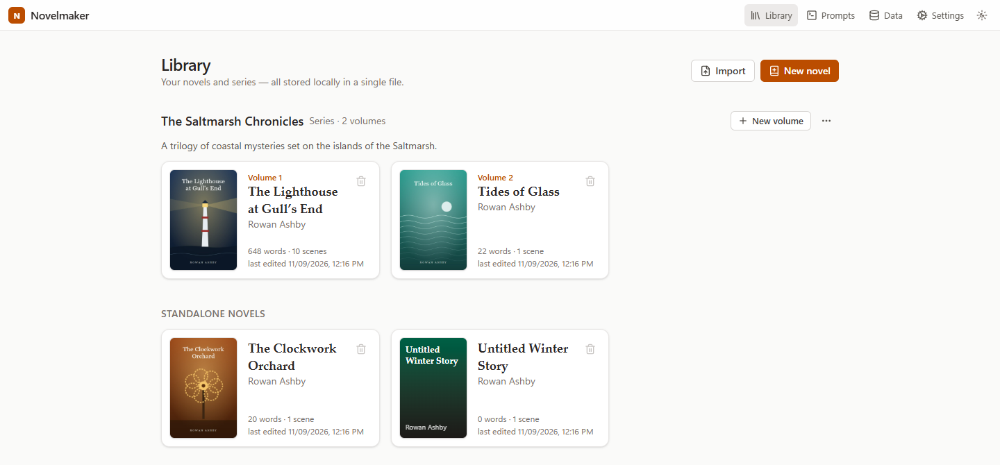

A novel can stand alone or be a volume of a series. Codex entries can belong to one volume or to the whole series, so characters carry over from book to book. Every novel can have a cover (upload or drag in an image). You can turn a standalone novel into a series, add it to an existing series, or take it out again.

### Writing

The main view (screenshot at the top) has three parts:

- **Outline:** acts, chapters and scenes, reordered by drag and drop. Acts and scenes are optional. A book without acts and with one text per chapter looks exactly like that.
- **Editor:** one scene at a time, or the whole manuscript as continuous text. Autosave, word counts, focus mode, dark mode. *Split* starts a new scene or chapter at the cursor.
- **Side columns:** the scene panel (title, summary, point of view, labels, versions, AI context) and a column of **pinned** items: codex entries, snippets or other scenes that you want to keep in view while writing.

Codex names and aliases are underlined in the text. Hovering shows a card, and *Ctrl+click* opens the entry right above the text. Each scene can have its own **point of view** (POV character and narrative perspective); by default it follows the novel. **Hidden notes** stay in the text for you but are not part of the manuscript and are never sent to the AI.

### Beats and variants

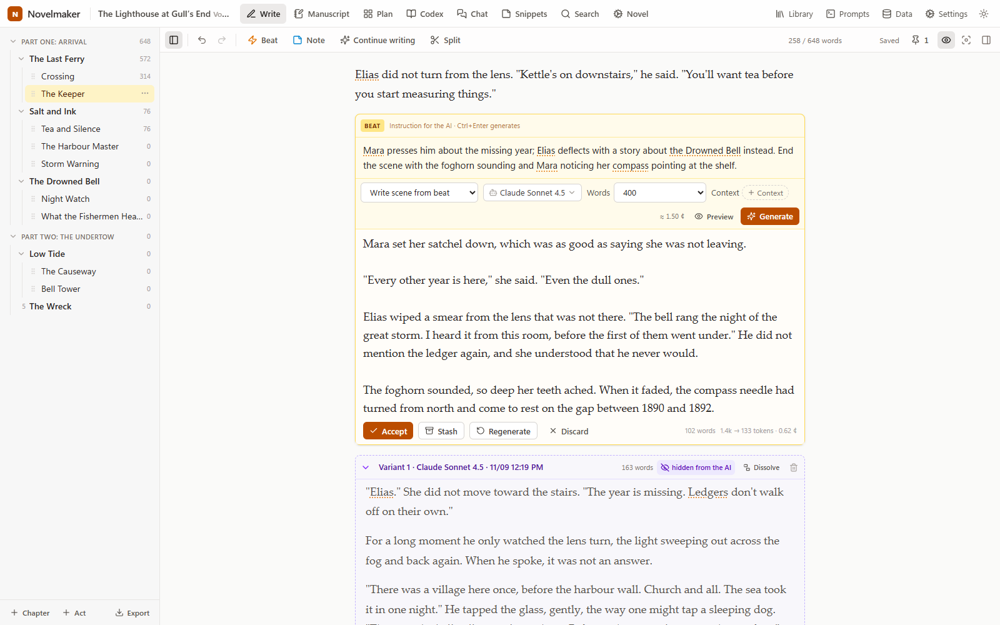

A **beat** is an instruction block inside the scene. You choose the prompt, the model and options such as the length ("Words: 400"). The answer streams in below the beat. Then:

- **Accept** puts the text into the scene (a version of the scene is saved first).
- **Stash** keeps the answer as a numbered variant in a **frame** under the beat, so you can try again and compare. Frames can be collapsed, given a title, dissolved into normal text or deleted. By default they are *hidden from the AI*: not sent in prompts, not counted, not exported.
- **Regenerate** or **Discard**.

### The "/" menu

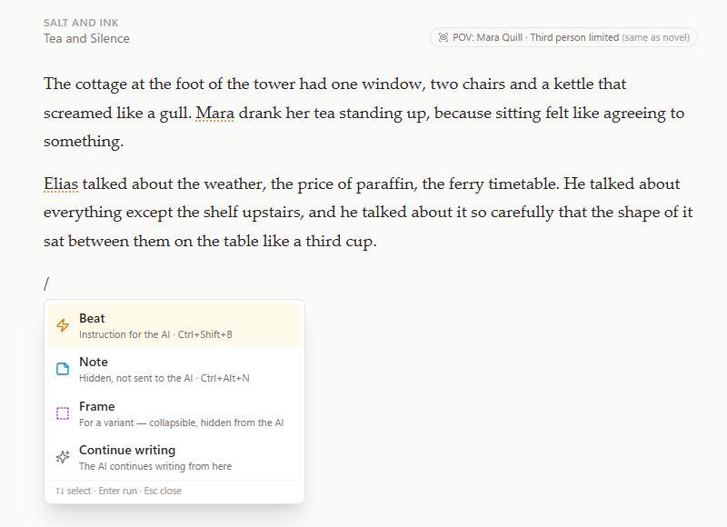

Type `/` at the start of an empty line to insert a beat, a note or a frame, or to let the AI continue writing from there. Typing filters the list (`/no` → Note).

### Rewrite, shorten, expand

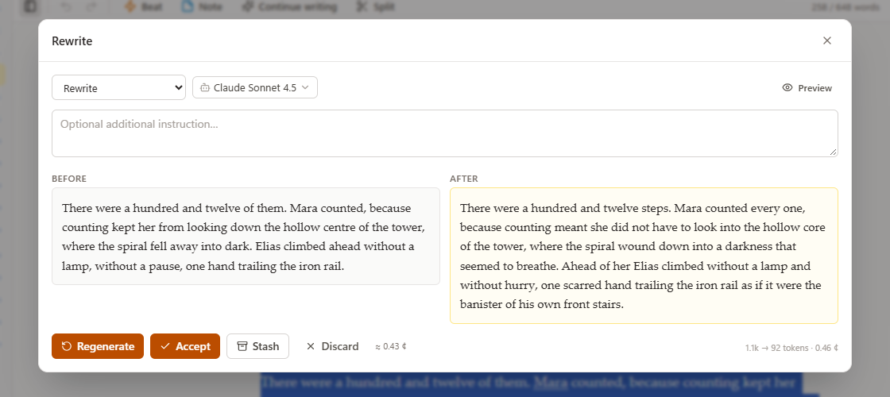

Select text and choose **Rewrite**, **Shorten**, **Expand** or **Instruction…** (your own instruction, e.g. "more tension, shorter sentences"). You see before and after side by side and can accept, stash or regenerate. **Continue writing** (toolbar or `/`) drafts the next passage from the cursor.

### Know the cost before you click

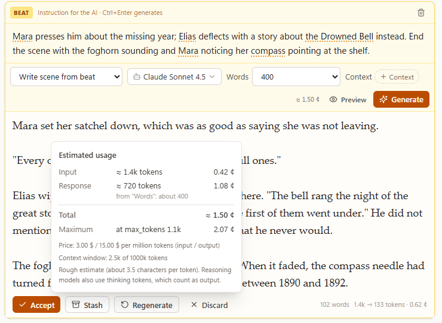

Every *Generate* button shows an estimate (e.g. "≈ 1.50 ¢"). Hovering it shows the details: input and response tokens, cost, the maximum at `max_tokens`, the model's price and how full the context window is. After the call, the real numbers from the provider are shown and kept in the log.

### Codex

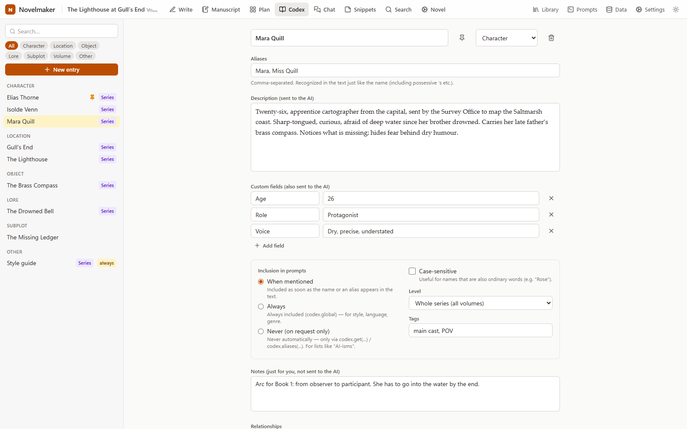

Characters, locations, objects, lore, subplots, volumes and anything else. Each entry has aliases, a description that is sent to the AI, private notes that are not, custom fields, tags and relationships. Recognition handles inflections and possessives ("Mara's" → Mara), and you can make an entry case-sensitive for names that are also ordinary words. **Inclusion** decides when an entry goes into a prompt:

- **When mentioned** (default): included as soon as its name or an alias appears near the cursor.
- **Always:** e.g. a style guide or world rules.
- **Never:** only when a prompt asks for it explicitly, e.g. a list of banned words.

### See what the AI sees

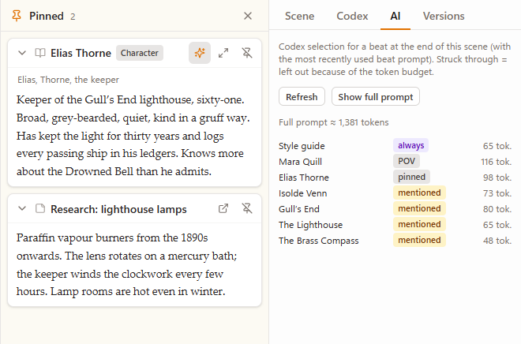

The **AI** tab of the scene panel lists which codex entries a beat would include and why (always, POV character, pinned, mentioned), with token counts. Entries that don't fit into the token budget are struck through. *Show full prompt* (or *Preview* next to any Generate button) shows the complete rendered prompt.

### Plan and summaries

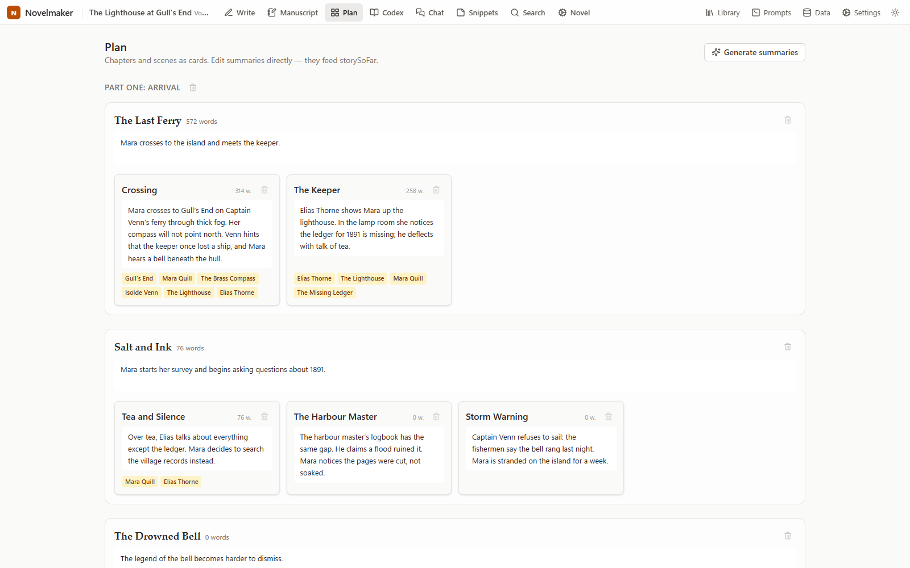

The plan shows chapters and scenes as cards with editable summaries. Summaries feed the "story so far" that beat prompts receive. **Generate summaries** runs as a background job with a cost estimate and progress: scenes → chapters → volume. A volume summary becomes a codex entry at series level, so the next book "knows" what happened before.

### Chat

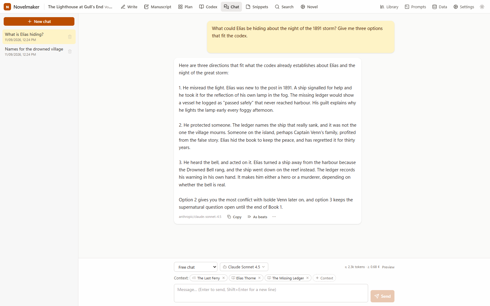

Saved chats per novel, with context you pick yourself: acts, chapters or scenes (full text or summary), codex entries, snippets, the whole novel or free text. Answers can be copied, saved as a snippet or codex entry, or **turned into beats in a scene**. Built in are a free chat and **Honest review**, which gives blunt reader feedback on the scenes, chapters or novel you attach.

### Prompt workshop

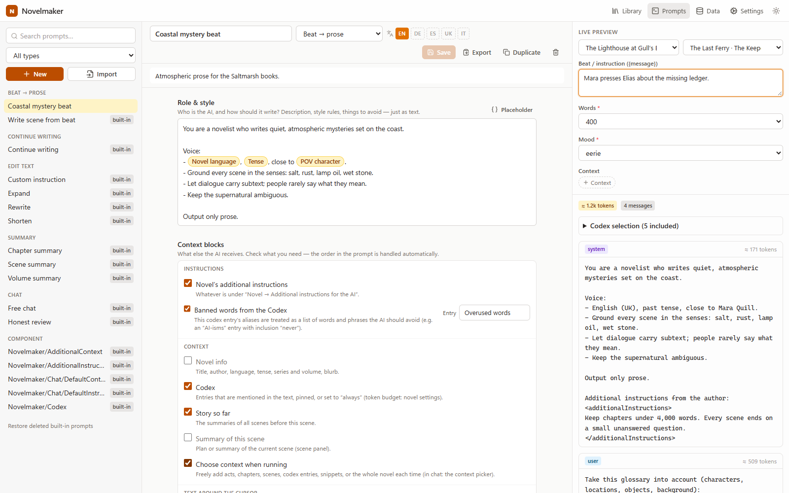

Prompts are built from **blocks**, with no code: a role and style text, context blocks you tick, a task and options you pick at run time. Placeholders such as *POV character* or *Tense* appear as chips. The live preview renders the prompt against a real scene of your novel. See [Prompt reference](#prompt-reference).

### Models and providers

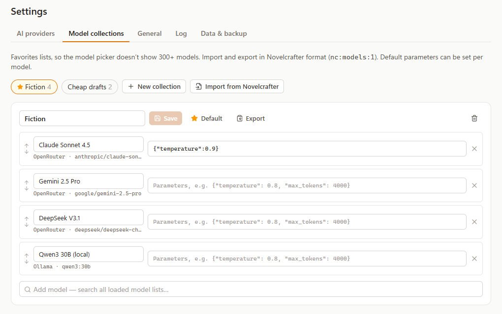

Add OpenRouter (with your API key) or a local server, load its model list, then collect your favourite models in **model collections** so the model picker stays short. Each model can carry default parameters (e.g. `{"temperature": 0.9}`). Collections can be imported from and exported to Novelcrafter.

### Import and export

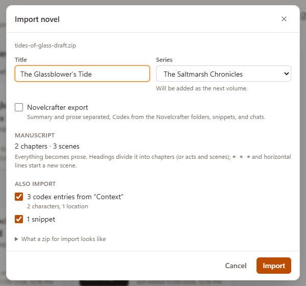

Import Word, Markdown, plain text or a zip with manuscript, codex folder and snippets, including complete Novelcrafter exports (see [Importing novels](#importing-novels)). The dialog shows what was found before anything is imported, and the book can join an existing series as its next volume. Export the whole novel or a single act, chapter or scene as Word (.docx) or Markdown, or copy it as formatted text (headings and italics survive pasting into Word). Prompts and model collections can be exchanged with Novelcrafter.

### Dark mode and focus mode

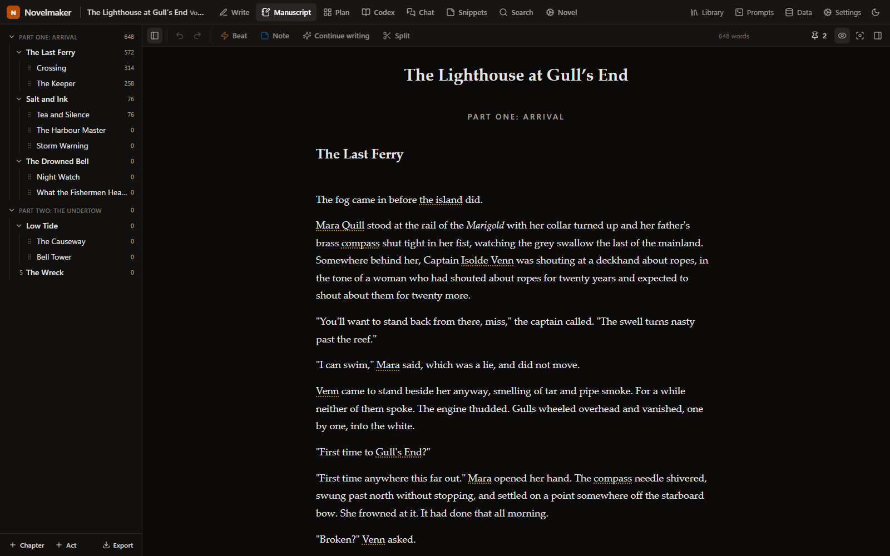

### Also included

- **Search** across scenes, codex and snippets.
- **Snippets:** free notes and research, usable as AI context.
- **Versions:** scene snapshots, created automatically before AI changes, restorable.
- **Log:** every generation with rendered messages, answer, tokens, cost and duration.

## Languages

Novelmaker supports six languages throughout: **English, German (Deutsch), Spanish (Español), Ukrainian (Українська), Italian (Italiano) and French (Français)**.

| What | How it works |
|---|---|
| **Interface** | **Settings → General → Language.** English is used on first start. The choice is stored in the database, so it follows you to other computers. Server messages (errors, background jobs) use the same language. |
| **Built-in prompts** | Every built-in prompt exists in all six languages. Every prompt, including your own, can keep one version per language. The prompt workshop shows a language bar (EN DE ES UK IT FR); if a version is missing, it falls back to another one and offers to copy it. |
| **Novel language** | Set per novel, independent of the interface language. It tells the AI which language to write in, so you can write in any language your model knows. Texts that Novelmaker adds to prompts by itself (the point-of-view sentence, labels such as "Chapter 3") follow the novel language for the six languages above and are English otherwise. |
| **Codex recognition** | Works with any alphabet (accents, umlauts, Cyrillic). The automatic endings (possessive *'s*, German *-s/-n/-en*) are tuned for English and German. For languages with many case endings, such as Ukrainian, add the inflected forms as aliases. |
| **This README** | English, Deutsch, Español, Українська, Italiano, Français (links at the top). |

The screenshots in all versions of this README show the English interface. If you want to improve a translation or add a language, **Settings → General → Help translate Novelmaker…** opens a table for it; details under [Translations](#translations).

## Getting started

### Requirements

[Node.js](https://nodejs.org) 22 or newer. Nothing else: the database is a file, and the web interface is built on first start.

### Start

**Windows:** double-click `start.bat`. The first start installs the dependencies and builds the interface (this takes a minute or two), then your browser opens <http://localhost:3000>. Later starts rebuild the interface only when the source code has changed.

**macOS, Linux or manually:**

```sh
npm install
npm run build
npm start          # server + interface on http://localhost:3000
```

**Stopping:** choose **Data → Quit Novelmaker** in the header, close the console window, or press `Ctrl+C` in it. In all three cases a backup is made first.

### First steps

1. **Settings → General:** pick the interface language. English is the default.
2. **Settings → AI providers:** add OpenRouter (enter your API key) and/or a local server, then click *Load / test models*.
3. **Settings → Model collections:** collect the models you want to use and mark one collection as default.
4. **Library → New novel**, or **Import** an existing manuscript.
5. **Novel** (in the novel's top bar): set language, tense, point of view and POV character. *Additional instructions for the AI* go into every beat and chat prompt.
6. Write. To get AI help, type `/` in an empty line, choose *Beat*, describe what should happen and press *Generate* (or `Ctrl+Enter`).
7. Optional: **Data → Storage location & backups** moves the database into a Dropbox or OneDrive folder, so you can work on several computers.

## How it works

### Architecture

```
Browser (http://localhost:3000)
  React · TipTap (text editor) · CodeMirror (prompt editor)
        │  REST + Server-Sent Events for streaming
        ▼
Node.js server (Fastify)
  ├─ SQLite database: one file with everything
  ├─ prompt engine and codex matcher (same code as in the browser)
  └─ LLM client ──▶ OpenRouter · Ollama · LM Studio · KoboldCpp · any OpenAI-compatible API
```

The server is needed for two reasons: browsers often cannot reach local AI servers directly (CORS), and a single database file is easier to back up and move than browser storage. The `shared/` package (prompt engine, codex matcher, types) runs both in the browser and on the server. That way the live preview and the name highlighting behave exactly like the real generation.

### How a novel is stored

- **Series → Novel (volume) → Act → Chapter → Scene.** Internally every level always exists. The interface hides the act level when there is only one act, and the scene level when a chapter has only one scene.
- **Scene text** is stored as a structured document (ProseMirror JSON) plus a plain-text copy. Beats, hidden notes and frames are blocks in the same document but are not part of the manuscript: they are not counted, not exported, and not sent to the AI as story text.
- **Codex entries** live at series level (shared by all volumes) or volume level. A volume entry with the same name overrides the series entry.
- Also stored: prompts (one version per interface language), providers, model collections, chats, snippets, scene versions and the generation log.

### What happens when you click Generate

1. The browser sends which prompt and model to use, your options (e.g. *Words: 400*, extra context) and where you are: scene, beat, cursor position or selection.
2. The server collects what the prompt's blocks ask for, for example novel details, the text before and after the cursor, the end of the previous scene, the summaries of all earlier scenes ("story so far") and any context you added.
3. **Codex selection:** it scans the scene and the beat for names and aliases, adds entries set to *always*, the POV character and pinned entries, ranks them (always > POV > pinned > mentioned > rest) and stops at the token budget set in the novel settings.
4. **Rendering:** the prompt's blocks are compiled into chat messages (system / user / assistant) and filled in by the template engine.
5. **Streaming:** `max_tokens` is derived from the *Words* option unless the model collection sets it. The request goes to the provider, and the answer streams back to the browser token by token.
6. **Your decision:** accept, stash, regenerate or discard. Every call is logged with the rendered messages, answer, tokens, cost and duration.

The **cost estimate** runs steps 1–4 without calling the model. Input tokens are estimated at about 3.5 characters per token. The answer length comes from *Words*, *Length* (summaries) or the selected text (rewriting). Prices come from the provider's model list: OpenRouter supplies them, and local servers count as free.

### Prompts: blocks, not code

A Novelmaker prompt consists of four parts (role & style, context blocks, task, options) and needs no programming. When you save it, Novelmaker compiles it into messages for its template engine. The same engine runs prompts imported from Novelcrafter, which use a small script language. Details are in the [Prompt reference](#prompt-reference).

## Importing novels

**Library → Import** accepts Word (`.docx`), Markdown (`.md`), plain text (`.txt`) or a zip. Before importing, a dialog shows what was found. There you can also choose an existing series; the novel then becomes its next volume.

- **By default everything is prose.** Headings divide the text into chapters (two heading levels: act + chapter; three: act / chapter / scene). `* * *` or a horizontal rule starts a new scene. In text files, lines like "Chapter 2: Title", "Prologue" or "Epilogue" become chapters and "Part 1" becomes an act.
- **Zip layout:**

  ```
  Novel.zip
    Manuscript.docx   (or .md/.txt; several files = one chapter each, sorted by number)
    Context/          one codex entry per file; subfolders Characters/, Locations/, Objects/, Lore/, Subplots/ set the type
    Snippets/         one snippet per file
  ```

  German folder names (`Kontext/`, `Figuren/`, `Orte/`, `Notizen/`, …) work too.
- Markdown files in `Context/` may start with a header such as `aliases: Anni, Mrs Berg`, `type: character`, `always: true` (or `never: true`). Further lines like `Age: 31` become custom fields.
- **Novelcrafter export:** a complete Novelcrafter zip is recognised automatically (the *Novelcrafter export* box is ticked). Summary and prose of each scene are separated at the dividing line, and codex, snippets and chats are taken from the Novelcrafter folders. Scenes without a line are classified automatically; you can override this in the dialog.
- Word files exported by Novelmaker can be imported again with the same outline.

## Prompt reference

### Block prompts

| Part | Content |
|---|---|
| **Role & style** | Free text: who the AI is and how it should write ("You are an honest editor…", a whole style guide, things to avoid). |
| **Context blocks** | Tick what the AI should get: the novel's additional instructions, banned words (the aliases of a codex entry), novel info, codex, story so far, the scene summary, context chosen at run time, the end of the previous scene (*n* words, optionally only with the same POV character), the text before the cursor (*n* words, optionally as a style example), the text after the cursor, the selected text, and for summaries the text to summarise. Only blocks that fit the prompt type are offered. |
| **Task** | Free text: what the AI should do (in chat: rules for the answers). |
| **Options** | Fields chosen when running, e.g. *Words: 200 / 400 / 600*. *Words* also limits the answer length; *Length* does the same for summaries. |

**Placeholders** appear as chips. Insert them with *Placeholder* or by typing `{{`: *Beat*, *Instruction*, *Perspective*, *POV character*, *Novel language*, *Tense*, *Novel title*, *Author*, *Series*, *Volume*, *Chapter*, *Scene*, plus every option (e.g. `{{Words}}`). They are stored as plain `{{Name}}`.

**New** creates a prompt with *all* blocks for its type, sensibly pre-set; untick what you don't need. You don't arrange the order yourself. Role and instructions become the system message, followed by the context, the text before the cursor as a style example (the model treats it as its own earlier output) and finally the task. In chat, everything goes into the system message. The live preview shows exactly what will be sent.

Prompt types: *Beat → prose*, *Continue writing*, *Edit text* (rewrite, shorten, expand, custom instruction), *Summary* (scene, chapter, volume), *Chat*, and *Component* (reusable parts for script prompts).

### Script prompts (imported)

Prompts imported from Novelcrafter stay script prompts and run unchanged. **Convert to blocks** creates a block copy if the prompt only uses common patterns; otherwise Novelmaker names the parts that have no block equivalent. The components `Novelmaker/Codex`, `…/AdditionalContext`, `…/AdditionalInstructions`, `…/Chat/DefaultContext` and `…/Chat/DefaultInstructions` are built in for this purpose, and references to `Novelcrafter/…` are rewritten to them on import.

```
{novel.title}   {wordsBefore(1500)}   {pov.character(scene.previous)}
{#if condition} … {#elseif condition} … {#else} … {#endif}
{! comment !}
"text" or 'text', numbers, + (concatenation), is, is not, in, and, or, not
```

Expressions may span several lines. In `#if`, a value is true if it is not empty. Function and input names are case-insensitive. Unknown functions produce a warning instead of an error. Lines consisting only of `{#if}`/`{#endif}`/comments disappear together with their line break. Empty messages are dropped, and consecutive messages of the same role are merged.

<details>
<summary>Function list</summary>

| Group | Functions |
|---|---|
| Novel | `novel.title`, `novel.author`, `novel.description`, `novel.summary`, `novel.language`, `novel.tense`, `novel.instructions`, `novel.hasSeries`, `novel.volume`, `novel.outline`, `novel.chapterSummaries`, `novel.fullText`, `novel.wordCount` |
| Series | `series.title`, `series.description`, `series.volumes` |
| Point of view | `pov`, `pov.character(scene?)`, `pov.name(scene?)`, `pov.type(scene?)` |
| Scene | `scene`, `scene.title(scene?)`, `scene.summary(scene?)`, `scene.fullText(scene?)`, `scene.previous(scene?)`, `scene.next(scene?)`, `scene.number(scene?)`, `scene.labels(scene?)`, `scene.wordCount(scene?)`, `scene.chapter(scene?)`, `storySoFar`, `previousScenes(n)` |
| Chapter | `chapter`, `chapter.title(chapter?)`, `chapter.summary(chapter?)`, `chapter.fullText(chapter?)`, `chapter.number(chapter?)`, `chapter.scenes(chapter?)`, `chapter.sceneSummaries(chapter?)`, `chapter.previous(chapter?)`, `chapter.next(chapter?)` |
| Act | `act`, `act.title(act?)`, `act.summary(act?)`, `act.fullText(act?)`, `act.number(act?)`, `act.chapters(act?)` |
| Text | `message`, `textBefore`, `textAfter`, `wordsBefore(n)`, `wordsAfter(n)`, `isStartOfText`, `selection`, `lastWords(text, n)`, `firstWords(text, n)`, `wordCount(text)`, `upper`, `lower`, `trim` |
| Codex | `codex.context`, `codex.global`, `codex.mentioned`, `codex.get(name, …)`, `codex.aliases(name)`, `codex.name/description/type(entry)`, `codex.field(entry, key)`, `codex.characters`, `codex.locations`, `codex.objects`, `codex.lore`, `codex.subplots`, `codex.volumes`, `codex.all`, `codex.byTag(tag)` |
| Snippets | `snippet.get(title)`, `snippet.text(snippet)` |
| Composition | `include("Component")`, `input("Name")`, `local("name", value?)` |
| Lists & format | `without(list, list2)`, `join(list, separator?)`, `count`, `first`, `last`, `list(…)`, `asXml`, `asMarkdown`, `asText` |
| Logic | `and(…)`, `or(…)`, `not(a)`, `isEmpty(a)`, `isNotEmpty(a)`, `is(a, b)`, `contains(list\|text, value)`, `if(cond, then, else?)`, `default(value, fallback)` |

Properties can be chained, e.g. `{scene.previous.summary}` or `{pov.character.name}`. Codex entries, scenes etc. are rendered as XML by default (`<character name="…" aliases="…">…</character>`); the novel settings also offer Markdown or plain text.

</details>

## Data, backups and several computers

- **Database:** by default `data/novelmaker.db`, one file with everything (including API keys in plain text).
- **Storage location** (Data → Storage location & backups): for example a Dropbox or OneDrive folder, to work on several computers. Novelmaker moves the file there, or uses a database that already exists there (e.g. on your second computer). No restart is needed. The choice is stored per computer in `data/config.json`.
- **Several computers:** work on only one at a time, and quit Novelmaker before switching. A lock file (`novelmaker.db.lock`) next to the database triggers a warning if it is still open elsewhere, and Dropbox/OneDrive conflict copies are reported too. The database runs without a WAL file, so after every save the complete state is in that one file.
- **Backups** (folder selectable, default `data/backups/`, the last N are kept): at start if the file has changed since the last backup, on quit, before deleting a novel or series, and on demand (Data → Back up now). Novel settings also offer a full JSON export.
- **Autosave:** text is saved 0.8 s after you stop typing, and at least every 3 s while you keep typing.
- **Restoring:** quit Novelmaker, copy a backup into the database folder and rename it to `novelmaker.db`.

## Keyboard shortcuts

| Keys | Action |
|---|---|
| `/` at the start of an empty line | Command menu (beat, note, frame, continue writing) |
| `Ctrl+Shift+B` | Insert beat |
| `Ctrl+Alt+N` | Insert hidden note |
| `Ctrl+Enter` in a beat | Generate |
| `Ctrl+Click` on a highlighted name | Open the codex entry |
| `Ctrl+S` | Save (novel settings, prompt editor) |
| `Ctrl+Z` / `Ctrl+Y` | Undo / redo (also brings back a deleted frame) |
| `Esc` | Close dialogs and menus, leave focus mode |

On macOS use `Cmd` instead of `Ctrl`.

## Configuration

| Environment variable | Default | Meaning |
|---|---|---|
| `PORT` | `3000` | Port of the server and the interface |
| `HOST` | `localhost` | Address the server listens on |
| `NOVELMAKER_DATA` | `data/` in the program folder | Folder for `config.json`, the database (unless moved) and backups |
| `NOVELMAKER_OPEN` | not set | `1` opens the browser after start (`start.bat` sets this) |

## Development

```sh
npm run dev        # hot reload: interface on http://localhost:5173, API on port 3000
npm test           # vitest (shared + server)
npm run typecheck  # TypeScript for all three packages
npm run i18n       # checks the translation files
```

```
start.bat             starts server + browser (installs/builds when needed)
shared/               prompt engine, codex matcher, block prompts, Novelcrafter codec, i18n, types (browser + server)
server/               Fastify, SQLite (better-sqlite3), LLM client (OpenAI-compatible, streaming), jobs, import/export
web/                  React, TipTap, CodeMirror, Tailwind
scripts/              build check for start.bat, translation checker
docs/screenshots/     images for this README
```

### Translations

Interface texts are written in English in the code and serve as keys (`t('Save')`). Every other language has a JSON file that maps the English text to its translation: `shared/src/i18n/locales/{de,es,uk,it,fr}.json`.

- **In the app:** **Settings → General → Help translate Novelmaker…** opens a table with the English text, another language for comparison and your translation. It filters missing texts and broken placeholders, saves straight into the language file and can download or import a language file. It is meant for people who help with translations; normal use doesn't need it.
- **By hand** (no programming needed): change the value in the JSON file. Keep placeholders such as `{n}` or `{name}` and tags such as `<b>…</b>` as they are. Plurals can be written as `{ "one": "…", "few": "…", "many": "…", "other": "…" }` (the rules come from `Intl.PluralRules`). `npm run i18n` reports missing keys and broken placeholders.
- Changes saved in the table apply immediately. Changes made directly in the files take effect at the next start: `start.bat` rebuilds the interface automatically, otherwise run `npm run build`.
- **Better English texts** are changed in the code. The key changes with them, so the other languages need the new key as well; `npm run i18n` lists what is missing.
- **Better prompt texts:** for your own use, just edit the prompts in the prompt workshop; each language has its own version. What ships with Novelmaker lives in `shared/src/promptlang.ts` (block framing, placeholder names, default roles and tasks), `shared/src/builtin.ts` (built-in prompts) and `shared/src/template/` (words the engine writes into prompts, such as the point-of-view sentence).
- **Adding a language** works through the same table, without programming:
  1. Under **Settings → General → Help translate Novelmaker…**, enter the language code in *New language (code)* (e.g. `pt` or `pt-BR`) and click **Start**. The table now has an empty column for the new language. With *Compare with* you can translate from a language you know better than English.
  2. Translate as much as you like; the *Missing* filter shows what is left. **Save** creates the language file (e.g. `shared/src/i18n/locales/pt.json`). Next time the language appears under *Translate into*, so you can continue later. **Download** gives you the file to send in.
  3. To make the language selectable in the app, a developer registers it: `Lang`, `LANGS` and `LANGUAGES` in `shared/src/i18n/index.ts` (including the import of the file) and the per-language prompt texts in the files above. TypeScript points out every place that still lacks the new language. Until then the translation stays in its file and nothing is lost.

## Known limitations

- **Novelcrafter import:** narrative perspective and language are not part of the export and have to be set afterwards under *Novel* (when importing into a series, they are taken from the previous volume). Scenes without a dividing line between summary and prose are classified by a heuristic (few long paragraphs without dialogue = summary), which you can override in the import dialog.
- **Personas** are not supported; `include("Novelcrafter/Personas")` is dropped on import.
- Token counts before sending are estimates (about 3.5 characters per token). After generation, the log shows the provider's real numbers.
- With **reasoning models**, some providers count the thinking towards `max_tokens`. In that case set a larger `max_tokens` (or e.g. `{"reasoning": {"effort": "low"}}`) as a parameter for that model in its collection.
